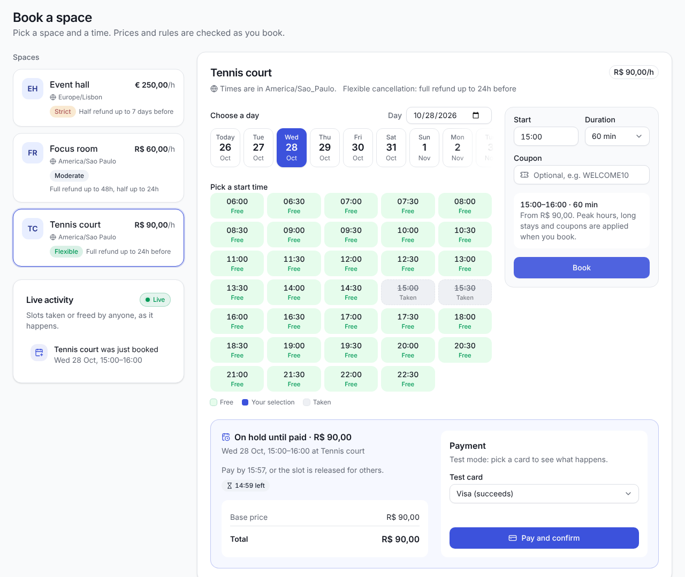

<h1>Hi, I'm Rafaella Godinho 👋</h1>

  <strong>Senior PHP Full-Stack Engineer</strong> · Rio de Janeiro, Brazil · working remotely

  I've spent 5+ years building and improving web systems that people rely on every day: a toll payment
  platform with 500,000+ users, one of Brazil's largest telecom sales portals, and a legacy PHP monolith
  used by 30,000+ people daily. I like making mature systems better <em>incrementally</em> rather than
  rewriting them, and I enjoy the full path from understanding the existing code and aligning with
  stakeholders to shipping changes safely.

  <a href="https://rafaellagodinho.vercel.app/">🌐 Portfolio</a> ·
  <a href="https://www.linkedin.com/in/rafaella-godinho/">💼 LinkedIn</a> ·
  <a href="mailto:rafaellagodinho@outlook.com">✉️ rafaellagodinho@outlook.com</a>

<h2>🧭 What I do</h2>

<ul>
  <li><strong>Legacy modernization</strong>: auditing technical debt, setting coding standards and progressively extracting services from PHP monoliths without disrupting operations</li>
  <li><strong>Payments</strong>: Stripe subscriptions and recurring billing, PIX and credit card flows, with transactional reliability</li>
  <li><strong>Back ends that scale</strong>: Laravel, Symfony and NestJS services, event-driven pipelines (SQS/SNS, RabbitMQ), caching and async processing to keep p95 latency low</li>
  <li><strong>Full-stack delivery</strong>: React, Vue and Next.js front ends, dashboards and multi-tenant products, shipped with Docker and CI/CD</li>
  <li><strong>AI in practice</strong>: LLM integrations with Azure OpenAI, and AI coding assistants in my daily workflow</li>
</ul>

<h2>💼 Recently</h2>

<table>
  <tr>
    <td><strong>Atento</strong> Senior Software Engineer · 2025–now</td>
    <td>Leading the modernization of a legacy PHP monolith (30,000+ daily users); CI/CD improvements that cut deployment lead time by 20%; multi-tenant BI with Superset and React; an AI data-processing platform with FastAPI and Azure OpenAI</td>
  </tr>
  <tr>
    <td><strong>Westwing</strong> Backend Engineer (contract) · 2025–now</td>
    <td>NestJS/Node.js microservices for high-traffic e-commerce checkout, orders and inventory; event-driven processing with AWS SNS/SQS and S3</td>
  </tr>
  <tr>
    <td><strong>Fadami</strong> Full Stack Engineer · 2023–2025</td>
    <td>Back end of a toll payment platform (500,000+ users, R$20M+ processed) with PIX and card payments; p95 under 200 ms under high load with Redis and RabbitMQ</td>
  </tr>
</table>

Earlier: Verum Digital (Laravel, multi-tenant contracts), freelance Laravel and Stripe work for international clients, the Oi Fibra sales portal at Elumini (Next.js, +60% organic traffic), and UNIFOA.

<h2>⭐ Featured project: <a href="https://github.com/godinhorafa/bookly">Bookly</a></h2>

  A space booking platform built to show how I design software end to end: a Laravel API around a
  framework-free domain, a NestJS real-time service and a React dashboard.

<ul>
  <li><strong>No double bookings</strong>, even under concurrent requests: a PostgreSQL exclusion constraint, proven by a test that races 8 processes</li>
  <li><strong>Strategy, Specification, Repository, Adapter and Observer</strong> where they earn their place, with layer rules enforced by architecture tests</li>
  <li><strong>Payments</strong> behind a gateway port (Stripe and fake adapters), idempotent retries, and unpaid bookings that expire without racing the charge</li>
  <li><strong>Transactional outbox</strong> feeding e-mail, signed webhooks and a <strong>NestJS</strong> WebSocket service that updates every open calendar</li>
  <li><strong>Tests at every layer</strong>, including Playwright end to end and a <strong>100% mutation score</strong> on the domain, plus 10 architecture decision records</li>
</ul>

<h2>🛠️ Tech stack</h2>

<table>
  <tr>
    <td><strong>Back end</strong></td>
    <td>
      
      
      
      
      
      
      
    </td>
  </tr>
  <tr>
    <td><strong>Front end</strong></td>
    <td>
      
      
      
      
      
    </td>
  </tr>
  <tr>
    <td><strong>Data & messaging</strong></td>
    <td>
      
      
      
      
      
    </td>
  </tr>
  <tr>
    <td><strong>Cloud & DevOps</strong></td>
    <td>
      
      
      
      
      
      
    </td>
  </tr>
</table>

Also: Symfony, AWS (SQS, SNS, S3), SQL Server, Stripe, PIX, C#, Pest, PHPStan, Playwright, GitLab CI/CD and Bitbucket Pipelines.

🌎 English (C1, fluent) and Portuguese (native). Comfortable working async with international, remote teams.

<h2>📫 Get in touch</h2>

  
  

